# Research on Modulation Identification Technology Based on Deep Learning [Attached with MATLAB and Python Code]

Modulation recognition technology has significant application value in both commercial and military fields. Modulation recognition can be categorized into two types: likelihood ratio-based modulation recognition and signal feature-based modulation recognition. Due to the high computational complexity of likelihood ratio-based modulation recognition, signal feature-based modulation recognition is generally more widely applied. Traditional signal feature-based modulation recognition involves designing and extracting signal features, followed by designing classification rules for modulation system classification based on these features. However, handcrafted signal features and classification rules often have limited accuracy in complex channel environments. Therefore, deep learning-based modulation recognition techniques have been proposed to automatically learn classification rules from feature data to improve classification accuracy. In recent years, with the development of deep learning, deep learning algorithms have been widely applied in computer vision and natural language processing, achieving outstanding performance. In the field of modulation recognition, utilizing the latest deep learning algorithms can simultaneously complete the automatic learning of signal features and classification rules, further enhancing modulation recognition performance.
Contents  
MATLAB code list

## Images

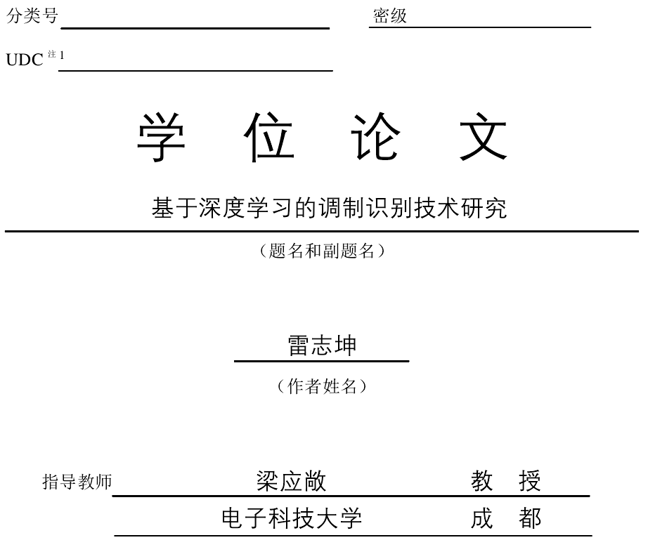
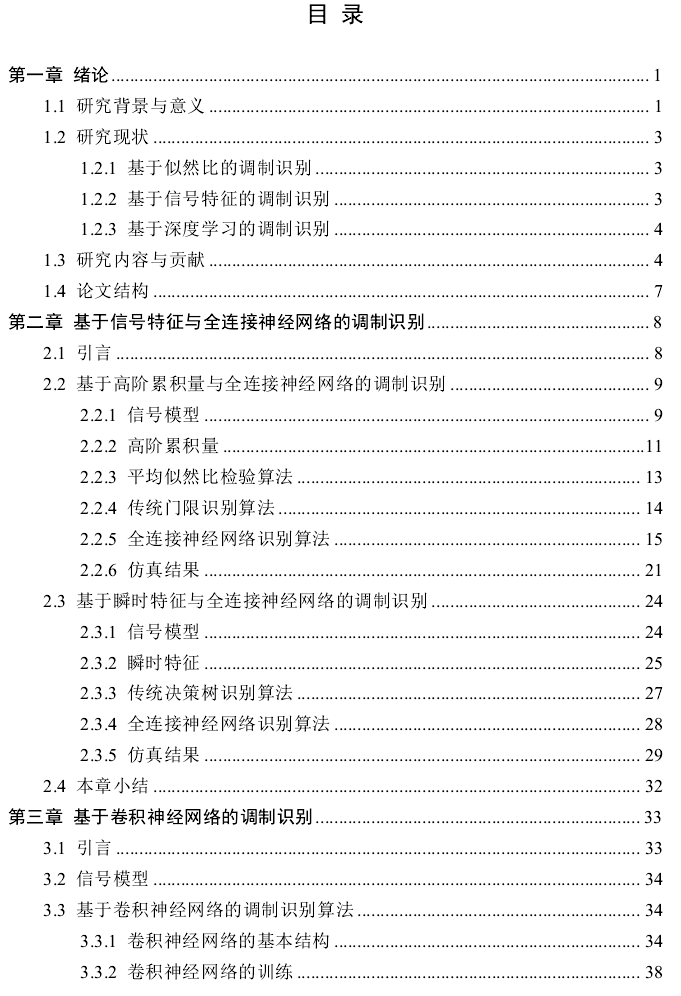
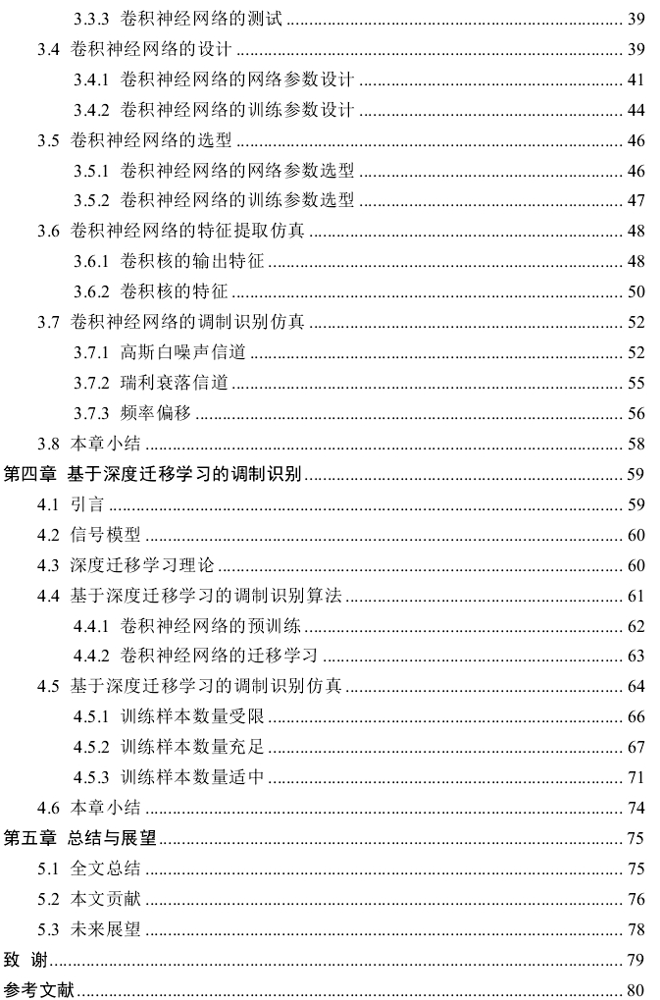
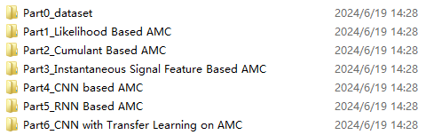
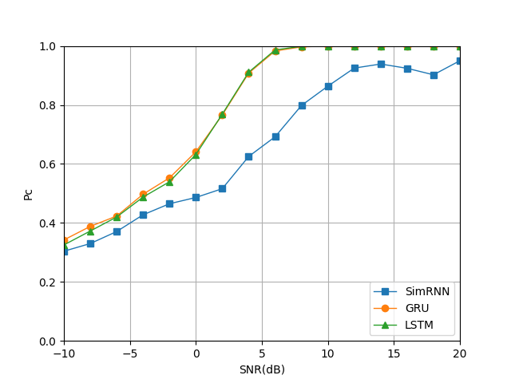
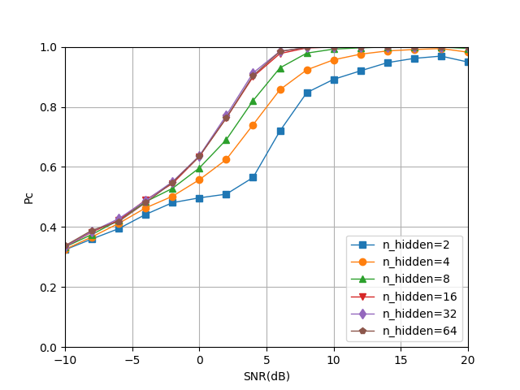
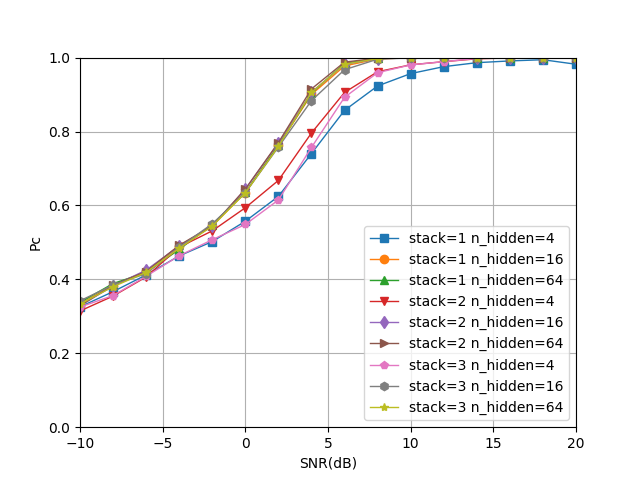
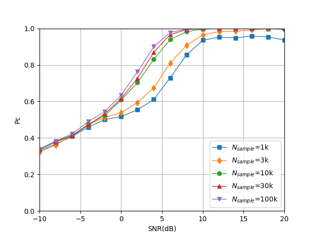
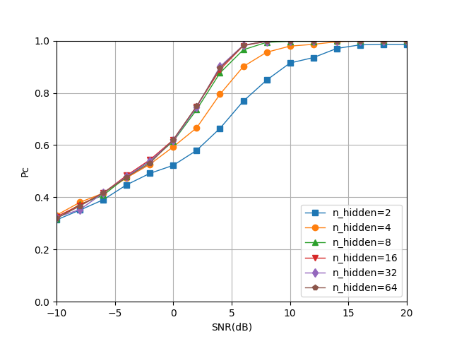
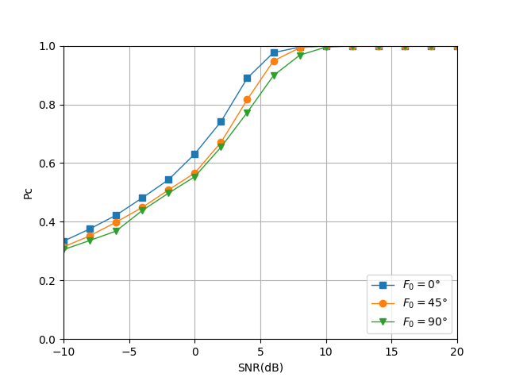
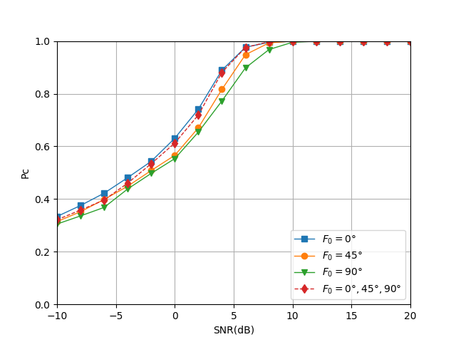
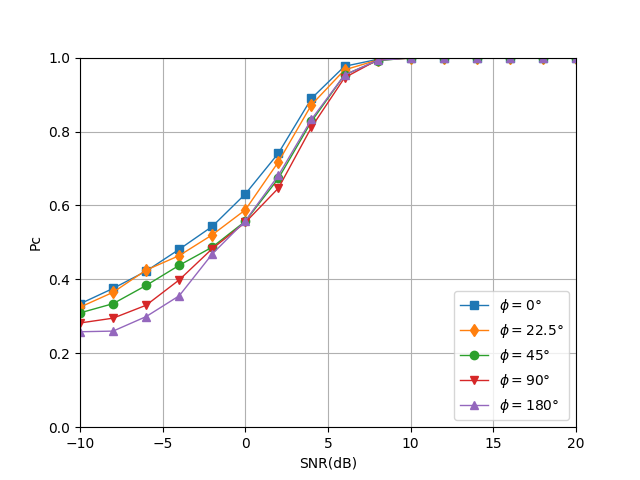
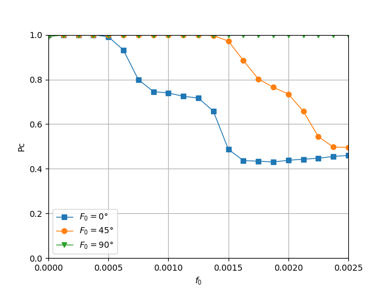
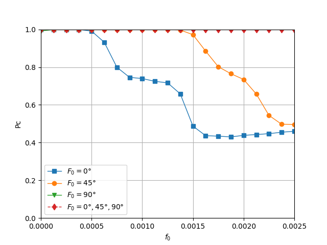
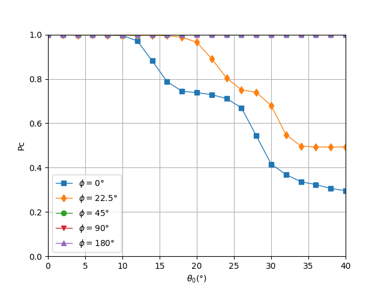

<!-- PAYMENT_BLOCK -->

## Get this dataset

- Payment link (Stripe): [Buy now](https://buy.stripe.com/3cs8yP7sY87d0vu9AB)
- Payment QR code: 

<!-- /PAYMENT_BLOCK -->
